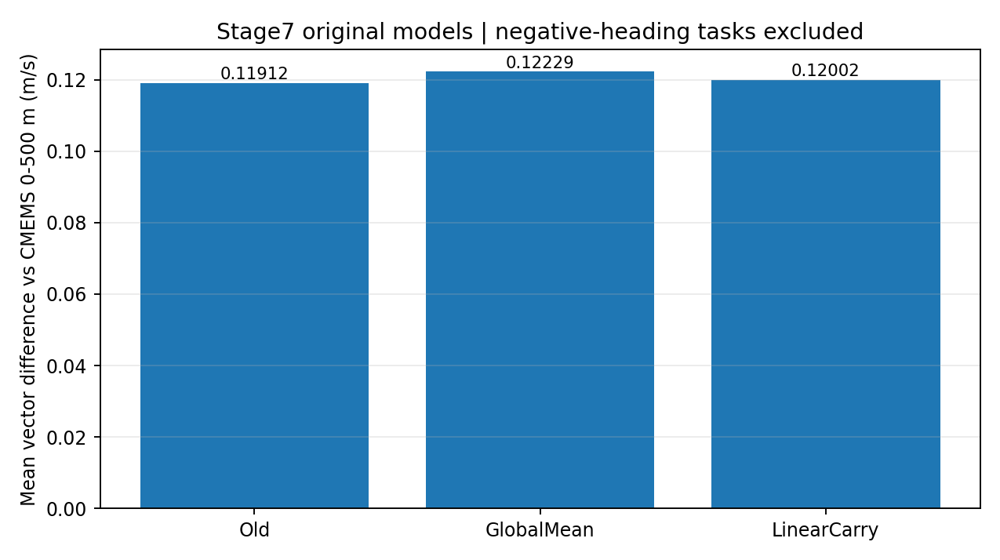
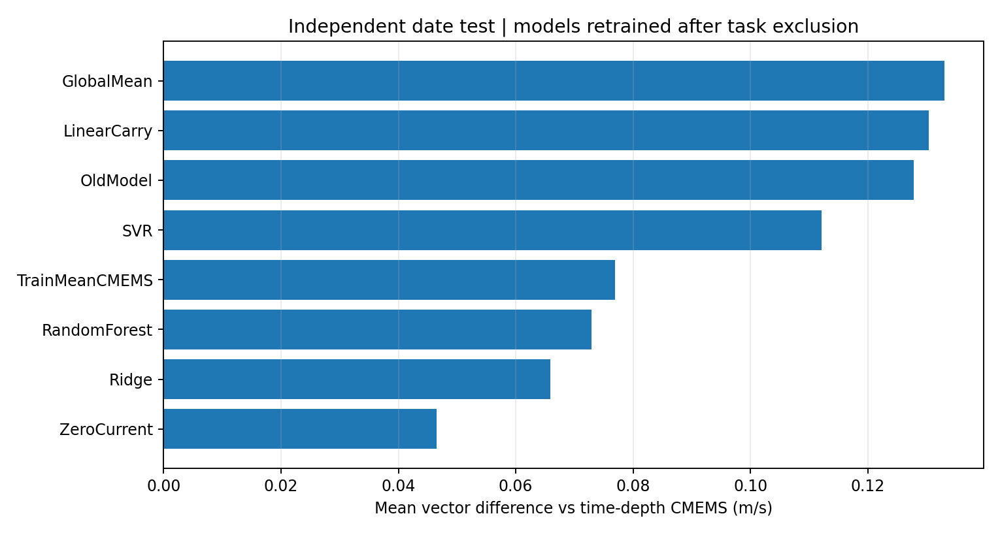
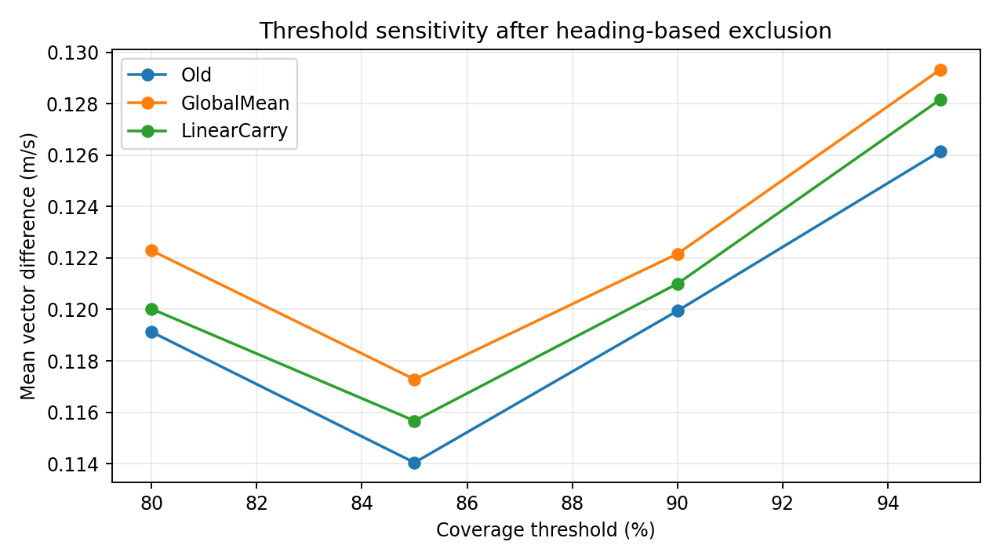

# 水下滑翔机海流特征估计：异常任务剔除后的模型分析

> **唯一展示版本：2026-11-18 保守剔除疑似负航向任务后的下游重算结果。**
> 本仓库不包含课题组提供的 CTD/TCM 质控程序、原始观测、完整任务级数据或 CMEMS 原始文件。

## 项目概述

该项目围绕水下滑翔机历史观测数据开展海流特征估计分析。上游 CTD/TCM 数据预处理与质控由课题组既有流程提供，本仓库**不发布相关程序，也不将其作为个人独立开发成果**。

公开部分聚焦于：对疑似异常航向任务执行保守剔除后，利用既有任务级运动学估计和 CMEMS 数值模式参考，重新开展同任务模型比较、训练/验证/测试日期隔离的机器学习拟合，以及覆盖率和重抽样敏感性分析。

**研究技术栈：** Python、NumPy、pandas、scikit-learn、Matplotlib；上游历史流程使用 MATLAB（非本仓库开源代码）。

## 唯一版本的研究流程

```text
课题组提供的原始观测预处理及质控（不公开）
            ↓
既有 299 任务的冻结运动学估计 / CMEMS 任务级参考（不公开）
            +
私有航向审计汇总表（不公开）
            ↓
按任务剔除含疑似负航向的 76 个任务
            ↓
保留 223 个任务
            ↓
按同一有效任务集合复算物理模型与 CMEMS 参考差异
            ↓
按日期划分数据，重新训练 Ridge / SVR / Random Forest
            ↓
零海流基线、覆盖率敏感性、日期聚类重抽样分析
            ↓
只公开统计汇总表和图
```

**注意：** 本次对保留任务重新执行的是下游计算、指标统计和机器学习训练；未重新运行原始 MATLAB 质控、逐任务动力学求解器，也没有重新取样 CMEMS。

## 数据筛选与样本数

| 统计口径 | 数量 |
|---|---:|
| 初始任务集合 | 299 |
| 含疑似负航向而整任务排除 | 76 |
| 最终保留任务 | **223** |
| 固定 0–500 m CMEMS 有效共同配对 | 193 |
| 固定 0–200 m CMEMS 有效共同配对 | 199 |
| 机器学习训练 / 验证 / 测试任务 | **113 / 16 / 64** |

原始航向值中的负数集中在约 -327.68 至 -295°；可能与 `int16` 编码回绕有关，**不等同于判定传感器损坏**。整任务剔除是保守的数据选择策略，可能引入样本选择偏差，不能据此宣称物理反演准确度提高。

## 研究结果（保留 223 任务后的口径）

### 物理模型与 CMEMS 0–500 m 参考比较

相同的 **193 个有效配对任务**，平均二维向量差（单位 m/s；越低表示与该**模式参考**越接近）：

| 模型 | 平均二维向量差 |
|---|---:|
| 既有估计 Old | 0.11912 |
| GlobalMean | 0.12229 |
| LinearCarry | 0.12002 |

### 日期隔离的机器学习测试集（64 个任务）

与时间—深度匹配 CMEMS 参考的平均二维向量差：

| 方法 | m/s |
|---|---:|
| **零海流基线** | **0.04652** |
| Ridge | 0.06588 |
| Random Forest | 0.07288 |
| SVR | 0.11214 |
| 原估计 OldModel | 0.12781 |

Ridge 是以验证集平均向量差选择的学习模型，但在独立日期测试集上**没有优于零海流基线**。因此，本项目侧重展示数据处理与科研评估流程，**不宣称已实现独立实测验证的高精度海流反演**。

## 结果图







## 仓库结构

```text
glider-current-estimation-filtered/
├── README.md
├── README_EN.md
├── src/
│   └── filtered_cohort_analysis.py   # 保守筛选后下游复算和 ML 训练
├── scripts/
│   ├── verify_repository.py          # 无私有输入时验证已公开指标
│   └── plot_public_results.py        # 从汇总表重新绘图
├── results/
│   ├── tables/                       # 仅汇总统计，不含任务级数据
│   └── figures/
├── docs/
│   ├── METHODOLOGY.md
│   ├── REPRODUCIBILITY.md
│   ├── PUBLISHING_CHECKLIST.md
│   └── GITHUB_UPLOAD_GUIDE.md
├── requirements.txt
└── .gitignore
```

## 快速检查公开结果

```bash
python scripts/verify_repository.py
pip install -r requirements.txt
python scripts/plot_public_results.py
```

若经授权持有原始任务级中间表与航向审计表，可按 [复现说明](docs/REPRODUCIBILITY.md) 运行完整的下游筛选与再训练。由于私有数据不随仓库发布，**公开版不能从零复现原始质控/运动学/CMEMS 匹配环节**。

## 公开边界与研究限制

- 不包含实验室/课题组质控算法、MATLAB 源码及其 `private/` 辅助函数。
- 不公开原始 CTD/TCM、CMEMS、设备航次、任务级预测、原始定位数据。
- 公开的汇总指标与图来自筛选后复算归档；正式将仓库设为 Public 前，仍应确认课题组对**汇总结果与研究图表**的公开许可。
- CMEMS 是数值模式产品，不是现场同步独立流速真值；所有误差均为“对模式参考的差异”。
- 任务按日期隔离，但不同日期/海况的泛化仍受限；同一日期任务非独立。

详见 [研究方法](docs/METHODOLOGY.md) 与 [发布前检查表](docs/PUBLISHING_CHECKLIST.md)。
